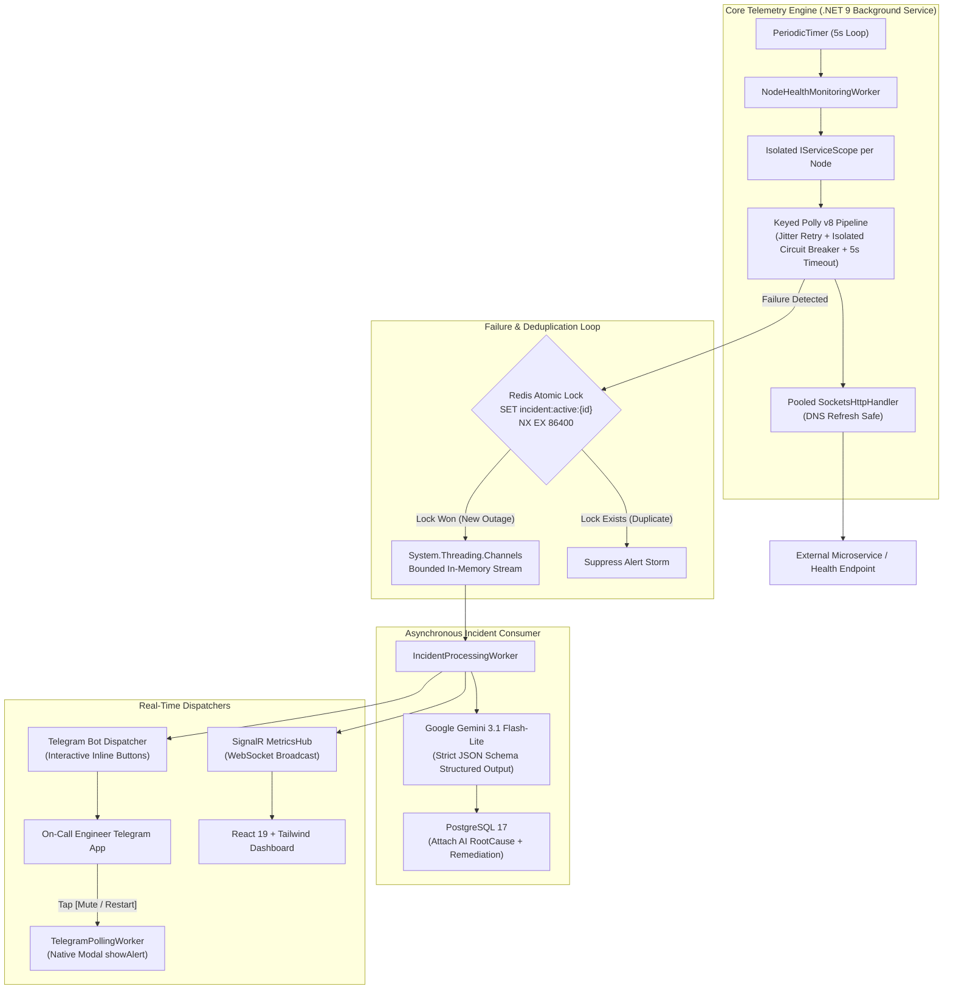

# NexusPulse v2.0

> **Distributed Observability, Autonomous AI Incident Response & Real-Time Telemetry Platform**  
> Built with **.NET 9**, **Clean Architecture**, **Polly v8 Resilience**, **Redis Distributed Locks**, **System.Threading.Channels**, **Google Gemini AI (Structured Outputs)**, **Telegram Bot API**, **SignalR**, and **React 19**.

[](https://dotnet.microsoft.com/)
[](https://learn.microsoft.com/dotnet/csharp/)
[](https://react.dev/)
[](https://tailwindcss.com/)
[](https://ai.google.dev/)
[](https://www.postgresql.org/)
[](https://redis.io/)
[](https://github.com/App-vNext/Polly)
[](https://github.com/legend-asp/NexusPulse)
[](LICENSE)

---

## 🌟 Executive Overview

**NexusPulse** is a mission-critical distributed telemetry and self-healing platform engineered to solve two pervasive problems in modern microservices:
1. **Alert Fatigue & Cascade Failures:** Traditional monitoring tools bombard engineers with hundreds of duplicate raw error logs when an upstream node fails, while slow monitoring requests lock up thread pools.
2. **Delayed Root-Cause Analysis (MTTR):** On-call engineers spend precious minutes digging through Prometheus/Grafana and Kibana logs to understand *why* an endpoint failed.

NexusPulse continuously probes registered microservices through **Keyed Polly v8 resilience pipelines**, isolates failing nodes via host-specific **Circuit Breakers**, deduplicates outage notifications using **Redis Distributed Locks (`When.NotExists`)**, routes failure events into an asynchronous non-blocking **`System.Threading.Channels` queue**, executes sub-second **AI Root Cause Analysis via Google Gemini (Structured JSON Schema)**, and dispatches rich interactive alerts to **Telegram** and a live **React 19 WebSockets Dashboard**.

---

## 📐 System Architecture



---

## 🧠 Key Senior Engineering Decisions & Trade-offs

| Problem / Challenge | Traditional / Flawed Approach | NexusPulse Senior Engineering Solution |
| :--- | :--- | :--- |
| **Alert Storms** | Sending a Telegram message on every failed healthcheck poll (200+ spam alerts/minute). | **Atomic Redis Lock (`When.NotExists`):** The lock key `incident:active:{nodeId}` is acquired atomically. Only the first failing poll wins the lock and emits an alert; subsequent polls silently update latency metrics until recovery. |
| **Cascade Outages** | Flooding a dying upstream server with retries until it crashes completely. | **Keyed Polly v8 Circuit Breaker:** Host-isolated circuit breaks open after 3 failures in a 60-second window, giving the upstream service 30 seconds of quiet time to recover. |
| **LLM Latency Bottleneck** | Calling Google Gemini synchronously inside the healthcheck loop (blocks the thread for 1.5–3.0s). | **Asynchronous Producer-Consumer (`System.Threading.Channels`):** The healthcheck loop pushes a lightweight event into an in-memory queue (`< 0.1ms`) and continues pinging nodes without blocking. An independent `BackgroundService` processes AI diagnosis. |
| **EF Core Concurrency** | Sharing a single `DbContext` instance across threads in `Parallel.ForEachAsync`. | **Per-Iteration `IServiceScopeFactory`:** Each parallel probe creates its own isolated DI scope and `DbContext`, guaranteeing zero `InvalidOperationException` collisions. |
| **LLM Output Hallucination** | Parsing unstructured free-form markdown or regex from LLM answers. | **Gemini Structured Outputs (`responseSchema`):** Enforces strict JSON Schema compliance at the model level (`rootCause`, `immediateFix`, `prevention`), mapping directly to C# strongly-typed `AiDiagnosis` records. |
| **Secrets & Leak Prevention** | Committing private API keys to GitHub. | **Multi-tier Secret Isolation:** `appsettings.json` contains safe templates; real development secrets reside in `.gitignored` `appsettings.Development.json`. |

---

## 🛠️ Technology Stack

### Backend
- **Framework:** .NET 9.0 (C# 13, Native AOT-ready)
- **Architecture:** Clean Architecture (Domain, Application, Infrastructure, Api)
- **Database & ORM:** PostgreSQL 17, Entity Framework Core 9.0 (Code-First Migrations, Fluent API)
- **Distributed Cache & Locking:** StackExchange.Redis 3.4
- **Resilience & Fault Tolerance:** Polly Core 8.9.1, Microsoft.Extensions.Resilience
- **Asynchronous Messaging:** System.Threading.Channels
- **AI Diagnostics:** Google Gemini 3.1 Flash-Lite REST API with JSON Schema
- **Bot Orchestration:** Telegram.Bot 22.10.4 (Interactive Long Polling + Inline Callback Queries)
- **Real-Time WebSockets:** ASP.NET Core SignalR
- **Testing:** xUnit, FluentAssertions, Moq

### Frontend
- **Framework:** React 19, TypeScript
- **Bundler & Tooling:** Vite 8.3
- **Styling:** Tailwind CSS v4 (Glassmorphism, Dark Mode)
- **Icons:** Lucide React
- **Real-time Client:** `@microsoft/signalr` with automatic reconnection and stale-closure safe hooks

---

## ⚡ Quickstart

### Option A: One-Click Launch via Docker Compose (Recommended)
Clone the repository and spin up the complete stack (PostgreSQL, Redis, .NET 9 API, React 19 Frontend):
```bash
git clone https://github.com/legend-asp/NexusPulse.git
cd NexusPulse
docker compose up -d --build
```
- **Web Dashboard:** [http://localhost:5173](http://localhost:5173)
- **Backend API & Swagger:** [http://localhost:5199/openapi/v1.json](http://localhost:5199/openapi/v1.json)
- **PostgreSQL:** `localhost:5435`
- **Redis:** `localhost:6380`

---

### Option B: Local Development

#### 1. Prerequisites
- [.NET 9.0 SDK](https://dotnet.microsoft.com/download/dotnet/9.0)
- [Node.js 22+ (LTS)](https://nodejs.org/)
- PostgreSQL & Redis running locally or via Docker:
  ```bash
  docker compose up -d nexus-postgres nexus-redis
  ```

#### 2. Backend Setup
Configure your keys in `src/NexusPulse.Api/appsettings.Development.json`:
```json
{
  "ConnectionStrings": {
    "DefaultConnection": "Host=localhost;Port=5435;Database=nexus_db;Username=postgres;Password=postgrespassword",
    "Redis": "localhost:6380"
  },
  "GeminiSettings": {
    "ApiKey": "YOUR_GEMINI_API_KEY",
    "Model": "gemini-3.1-flash-lite"
  },
  "TelegramSettings": {
    "BotToken": "YOUR_TELEGRAM_BOT_TOKEN",
    "ChatId": "YOUR_TELEGRAM_CHAT_ID"
  }
}
```
Run database migrations and launch the backend:
```bash
dotnet run --project src/NexusPulse.Api
```

#### 3. Frontend Setup
```bash
cd frontend
npm install
npm run dev
```
Open **[http://localhost:5173](http://localhost:5173)** in your browser.

---

## 🧪 Running Automated Tests

NexusPulse includes comprehensive unit tests covering domain invariants, Polly retry policies, in-memory event channels, and mocked Gemini AI schema parsing:

```bash
dotnet test
```

```text
Passed!  - Failed: 0, Passed: 13, Skipped: 0, Total: 13, Duration: 815 ms - NexusPulse.UnitTests.dll (net9.0)
```

---

## 📡 REST API & WebSockets Reference

| Method | Endpoint | Description |
| :--- | :--- | :--- |
| `GET` | `/api/nodes` | List all monitored nodes with health statuses and intervals |
| `POST` | `/api/nodes` | Register a new microservice endpoint for observability |
| `GET` | `/api/nodes/{id}` | Retrieve details and status of a single monitored node |
| `POST` | `/api/nodes/{id}/simulate-failure` | Simulate an instant node outage to test AI response and alerts |
| `DELETE` | `/api/nodes/{id}` | Remove a node from monitoring |
| `GET` | `/api/incidents` | List incident history with attached Google Gemini diagnoses |
| `WS` | `/hubs/metrics` | SignalR Hub streaming live metrics and incident alerts |

---

## 👨‍💻 Author

**Aleksandr Weber (`legend-asp`)**  
*Middle .NET Backend Engineer | Distributed Systems & Cloud Architecture*  
- **GitHub:** [@legend-asp](https://github.com/legend-asp)
- **Portfolio Projects:** [NexusPulse](https://github.com/legend-asp/NexusPulse), [SubFlow](https://github.com/legend-asp/SubFlow), [FlashCommerce](https://github.com/legend-asp/FlashCommerce), [VoiceTexterBot](https://github.com/legend-asp/VoiceTexterBot)

---

## 📄 License
This project is licensed under the [MIT License](LICENSE).
